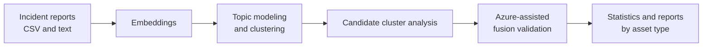
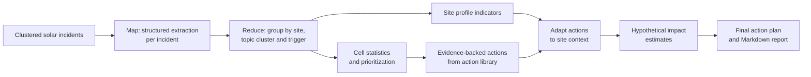

# DataChallengeCapGemini

Project for the **Capgemini Data Challenge at Mines Paris 2026**: turning incident reports for photovoltaic (solar) and wind assets into structured analysis and maintenance recommendations.

## Problem

Incident information is distributed across a CSV and PDF reports. The challenge was to extract and organize that information, identify recurring failure themes and likely causes, compare incidents across sites, and turn the findings into practical remediation actions.

The analysis targets **topic modeling**, **root-cause analysis**, **site and asset statistics** (including severity, downtime and cost), and **prioritized maintenance recommendations**.

## Project presentation

See the [presentation delivered at the university](Presentation.pptx).

## Main workflows and related components

The repository contains two main analysis workflows, as well as related notebooks. The directories separate experiments and responsibilities.
We implemented a fully functional pipeline generating a PDF report, and explored another approach based on map reduce.

Since this was short-term academic work, we did not consolidate these flows into a single, unified pipeline.

### 1. Functional pipeline test — clustering and statistical reporting

It embeds incident text, tests BERTopic clustering configurations, compares candidate topics, uses Azure OpenAI with Langgraph to review possible cluster fusions, and generates statistical reports.



The functional pipeline and reporting documentation are in [`functional_pipeline_test/`](functional_pipeline_test/) and [`functional_pipeline_test/REPORTING.md`](functional_pipeline_test/REPORTING.md). When generated, statistical reports for solar and wind are written to `functional_pipeline_test/reports/solar/` and `functional_pipeline_test/reports/wind/`. They include plots, statistical tests and a PDF report.

### 2. Map-reduce exploratory approach — recommendations

This solar-focused workflow first uses an LLM to extract structured evidence and failure information from each clustered incident. It then groups incidents into cells keyed by **site, topic cluster, and trigger**, computes cell-level statistics and priorities, and proposes evidence-backed remediation actions. Recommendations are adapted to measured site profiles, given hypothetical impact estimates, and assembled into a final action plan and report.



The map-reduce recommendation scripts are in [`map-reduce__exploratory/`](map-reduce__exploratory/). The BERTopic starter notebook and its separate clustered-noise exploration are in [`topic_modeling/`](topic_modeling/); their results were then implemented into the functional_pipeline. Equipment report documentation and its walkthrough are in [`equipment_analysis/`](equipment_analysis/). The walkthrough demonstrates the `dc equipment` feature implemented in [`src/datachallengecapgemini/`](src/datachallengecapgemini/).


Example solar recommendation reports in the current working copy are `final_action_report_solar.md` and `final_action_report_solar_abbreviated.md`. The map-reduce scripts' default action-plan JSON/CSV outputs are under `data/`. These are generated/local artifacts and are not guaranteed to be present in a repository clone.

The dataset and generated data artifacts are not tracked by Git and are therefore not included in a repository clone.

The first building block — topic modeling — was provided as a notebook and converted to a [marimo](https://marimo.io) notebook.

## Technical and scientific highlights

- **BERTopic for explainable incident themes.** Text embeddings capture semantic similarity; UMAP reduces their dimensionality, HDBSCAN discovers clusters (and leaves outliers as noise), and a French `CountVectorizer` extracts representative words. In the functional pipeline, we scan `min_cluster_size` values, compare how topics merge, and use Azure OpenAI to review candidate fusions rather than treating one clustering configuration as definitive. See [`functional_pipeline_test/clustering_module.py`](functional_pipeline_test/clustering_module.py) and the [topic-modeling notebook](topic_modeling/starterkit_students.py).
- **LangGraph for equipment-report recommendations.** In the separate `dc equipment` feature, [`src/datachallengecapgemini/report_factory.py`](src/datachallengecapgemini/report_factory.py) passes a shared typed state through three sequential nodes: identify cost drivers, draft recommendations, then prioritize them. This is not part of `functional_pipeline_test`.
- **Map-reduce with structured, traceable extraction.** In the exploratory solar workflow, an LLM extracts incident-level fields using a JSON schema, including the evidence level and a supporting quote. The quote is checked against the source report, and unknown causes are kept explicitly unknown instead of being presented as facts. Deterministic aggregation and prioritization then combine the extracted incidents into site/topic/trigger cells.
- **Statistical safeguards.** The functional reports test topic–severity association with chi-square tests, use seeded Monte Carlo p-values for sparse tables, and apply Benjamini–Hochberg correction across asset types. The exploratory site-profile analysis uses chi-square tests and Holm correction when comparing sites. These checks help avoid over-interpreting chance differences across multiple comparisons.
- **Decision support with explicit assumptions.** The recommendation workflow combines measured cost, downtime, severity and recurrence with Pareto-based prioritization and site indicators. Estimated action benefits are scenario-based hypotheses from the action library, not guaranteed savings; they are labeled as such and should be validated against operational outcomes.

**Scientific limitation:** these analyses identify patterns and associations, not proven causes. Incident records may be incomplete or dependent, topic clusters are learned from the same data being analyzed, and some clustering choices may incorporate severity during review. Results should therefore support expert investigation, not replace it.

## Project structure

The repository is organized as follows. The incident dataset, PDFs, `.env`, and generated analysis outputs are local files and are not included in a clone.

```
├── functional_pipeline_test/       # Functional BERTopic pipeline and statistical reports
├── map-reduce__exploratory/        # Map-reduce recommendation workflow and site stats
├── topic_modeling/                 # BERTopic starter notebook and noise exploration
├── equipment_analysis/             # Equipment report docs and marimo walkthrough
│   ├── PIPELINE_EQUIPMENT.md
│   └── equipment_pipeline_walkthrough.py
├── src/datachallengecapgemini/     # Main Python package and `dc` CLI
├── templates/                      # Solar, wind, and equipment report templates
├── tests/                           # Automated tests
├── data/                            # Local inputs and generated outputs (gitignored)
├── .env.example                     # Azure OpenAI configuration template
├── pyproject.toml                   # Project metadata and dependencies (uv)
├── uv.lock                          # Locked dependency versions
└── .python-version                  # Python version pin (3.13)
```

### `map-reduce__exploratory/` at a glance

The scripts are small, separately runnable steps rather than one orchestrated CLI. Most accept `--help` and default to inputs/outputs under `data/`; run commands from the repository root. The usual recommendation flow is extraction → cell-level prioritization and site mapping → action selection → site adaptation → impact estimate → final plan → report.

| File | Role / when to use it |
| --- | --- |
| [`organized_extraction_agent.py`](map-reduce__exploratory/organized_extraction_agent.py) | Baseline Azure-assisted incident extraction. Use `--extract-organized` to extract structured fields for the solar incidents; it writes `data/incidents_organized_solar.csv`. |
| [`organized_extraction_agent_turbo.py`](map-reduce__exploratory/organized_extraction_agent_turbo.py) | Parallelized variant of the organized extraction step. Choose this **or** the baseline script; both write the same organized incident output. |
| [`fixing_plan_agent_cellulization.py`](map-reduce__exploratory/fixing_plan_agent_cellulization.py) | Deterministically aggregates organized incidents into site/topic/trigger cells, computes priorities, and writes `data/fixing_plan_solar.csv`. |
| [`site_mapping_agent.py`](map-reduce__exploratory/site_mapping_agent.py) | Computes site-profile indicators and statistical comparisons from organized incidents; writes `data/site_mapping_solar.json`. |
| [`fixing_plan_agent_remediation.py`](map-reduce__exploratory/fixing_plan_agent_remediation.py) | Uses cell statistics, incident evidence, and the action library to select remediation candidates; writes `data/fixing_plan_remediation_solar.json`. |
| [`site_profile_adaptation.py`](map-reduce__exploratory/site_profile_adaptation.py) | Adapts remediation candidates using measured site indicators; writes `data/fixing_plan_remediation_solar_adapted.json`. |
| [`impact_estimation.py`](map-reduce__exploratory/impact_estimation.py) | Adds low/central/high hypothetical avoided-cost estimates from the action library; writes `data/fixing_plan_remediation_solar_impact.json`. |
| [`final_action_plan.py`](map-reduce__exploratory/final_action_plan.py) | Consolidates the impact-enriched recommendations and incident evidence into the final action plan JSON and CSV. |
| [`report_generation.py`](map-reduce__exploratory/report_generation.py) | Renders the final plan as full or abbreviated French Markdown reports. |
| [`stats_agent.py`](map-reduce__exploratory/stats_agent.py) | Separate deterministic descriptive/statistical analysis of the clusterized solar CSV; displays interactive plots and is not a step in the remediation-plan chain. |

The BERTopic notebook and `C_NOISE` exploration are in [`topic_modeling/`](topic_modeling/); the `dc equipment` walkthrough is in [`equipment_analysis/`](equipment_analysis/). They are related experiments/features, not map-reduce steps.

For script-specific options, inspect its help before running, for example:

```bash
uv run python map-reduce__exploratory/fixing_plan_agent_remediation.py --help
```

## Prerequisites

- **Python 3.13** (pinned in `.python-version`)
- **[uv](https://docs.astral.sh/uv/)** — fast Python package and environment manager

Install uv if you don't have it (here is the command for linux installation):

```bash
curl -LsSf https://astral.sh/uv/install.sh | sh
```

Scanned-PDF preprocessing uses Surya OCR with a llama.cpp server. Install
[llama.cpp](https://github.com/ggml-org/llama.cpp/blob/master/docs/install.md),
including the `llama` command with the `serve` subcommand:

```bash
curl -LsSf https://llama.app/install.sh | sh
```

Start the server in a separate terminal. The `-hf` option downloads Surya's
GGUF model and its multimodal projector automatically the first time:

```bash
llama serve -hf datalab-to/surya-ocr-2-gguf \
  --host 127.0.0.1 \
  --port 8080 \
  --alias datalab-to/surya-ocr-2 \
  --ctx-size 16384 \
  --parallel 1
```

Keep that server running while preprocessing. In another terminal, point Surya
to it and run the preprocessing command. In Bash:

```bash
export SURYA_INFERENCE_URL=http://127.0.0.1:8080/v1
uv run dc preprocess
```

In PowerShell:

```powershell
$env:SURYA_INFERENCE_URL = "http://127.0.0.1:8080/v1"
uv run dc preprocess
```

Preprocessing does not start the server or download the model. It stops with
an error if `SURYA_INFERENCE_URL` is missing, or if the configured server is
unavailable or serving a different model.

The final pipeline step converts the markdown reports to PDF with
[pandoc](https://pandoc.org/). For the latest release, use the installer for
your platform from the [pandoc GitHub releases](https://github.com/jgm/pandoc/releases/latest)
(for example, the `.msi` on Windows, `.pkg` on macOS, or `.deb` on Debian/Ubuntu).
See Pandoc's [installation guide](https://pandoc.org/installing.html) for other
platforms and installation options. Make sure the `pandoc` command is on your
`PATH`.

PDF export also requires `xelatex`, the PDF engine used by this project. It is
available in [TeX Live](https://www.tug.org/texlive/) and other TeX
distributions; choose the installation for your operating system:

- **Debian/Ubuntu:** install XeLaTeX and commonly needed LaTeX packages:
  `sudo apt install texlive-xetex texlive-latex-recommended texlive-latex-extra texlive-fonts-recommended`.
- **macOS:** install [MacTeX](https://tug.org/mactex/) for the more complete
  setup. [BasicTeX](https://tug.org/mactex/morepackages.html) is a smaller
  alternative, but may need additional TeX packages installed with `tlmgr`.
- **Windows:** install [MiKTeX](https://miktex.org/download) and allow it to
  install missing packages when prompted.

Check that both commands are available before running the pipeline:

```bash
pandoc --version
xelatex --version
```

Without pandoc, the pipeline stops with an error at the last step; you can
skip that step with `uv run dc --skip-pdf`.

## Setup

### 1. Clone and enter the project

```bash
git clone <repo-url>
cd DataChallengeCapGemini
```

### 2. Install dependencies

`uv` reads `pyproject.toml` and creates a virtual environment in `.venv/` automatically:

```bash
uv sync
```

This installs all runtime dependencies (BERTopic, HDBSCAN, UMAP, pandas, OpenAI SDK, etc.)
and the dev dependencies (marimo).

### 3. Configure environment variables

The pipelines use Azure OpenAI for embeddings and/or chat completions. Copy the
provided `.env.example` to `.env` in the project root:

```bash
cp .env.example .env
```

In PowerShell:

```powershell
Copy-Item .env.example .env
```

Fill in your Azure OpenAI credentials:

```dotenv
AZURE_OPENAI_API_KEY=your-api-key
AZURE_OPENAI_ENDPOINT=https://<your-resource>.cognitiveservices.azure.com/
AZURE_OPENAI_API_VERSION=2024-12-01-preview
AZURE_OPENAI_CHAT_DEPLOYMENT=<your-chat-deployment-name>
AZURE_OPENAI_EMBEDDING_DEPLOYMENT=<your-embedding-deployment-name>
```

> **Note:** `.env` is listed in `.gitignore` — never commit your API keys.
> The endpoint must be the Azure OpenAI **resource** endpoint, not a `/api/projects/...` URL.

### 4. Data

The dataset (`data/incidents_students.csv` and the PDF folders) is gitignored and
is therefore not included in a clone. Obtain the data from the hackathon organizers
and place it in the `data/` directory at the project root.

The CSV contains 1800 incident reports with columns such as `incident_id`, `site`,
`asset_type`, `date`, `severity`, `downtime_hours`, `estimated_cost_eur`,
`weather_condition`, `text`, `document_format`, and `document_path`.

Three document formats are present:

| Format        | Description                                   | Location            |
|---------------|-----------------------------------------------|---------------------|
| `text`        | Text already available in the CSV             | `text` column       |
| `pdf_digital` | Digital PDF (extractable text)                | `data/pdf_digital/` |
| `pdf_scan`    | Scanned PDF (image, requires OCR)             | `data/pdf_scan/`    |

The starter kit only uses the `text` subset (~600 reports) to get you started quickly.

## Running the pipeline

The CLI is a single command, `dc`, with subcommands for specific tasks:

| Command | Description |
|---------|-------------|
| `uv run dc` | Main pipeline: plotting → reporting → PDF export |
| `uv run dc --all` | Main pipeline, recomputing every step (including clustering) |
| `uv run dc preprocess` | Preprocessing only: OCR scanned PDFs and parse them into a merged CSV |
| `uv run dc equipment --site OUEST1` | Equipment-level reports (see below) |

### Main pipeline

```bash
uv run dc
```

By default, `dc` skips the clustering step (the only CSV → CSV step) and
reads the pre-existing `data/incidents_clusterised_solar.csv` and
`data/incidents_clusterised_wind.csv` files. Override their locations with
`--solar-csv` and `--wind-csv`. Solar and wind plots are written separately
under `data/plots/solar` and `data/plots/wind`.

To recompute every step — including clustering, which turns the merged
incidents CSV into the clusterised solar and wind CSVs — use `--all`:

```bash
uv run dc --all
```

Preprocessing is intentionally **not** part of the main pipeline; run it
separately with `dc preprocess` (see [Prerequisites](#prerequisites) for the
Surya server setup).

The pipeline ends with a report-generation step: it fills the markdown
templates in `templates/` (`solar_report.md`, `wind_report.md`) with
statistics computed from the clusterised CSVs, figures from
`data/plots/<label>/png`, and prose generated by Azure OpenAI report agents.
The filled reports are written to `filled_templates/solar/report.md` and
`filled_templates/wind/report.md`. Templates use `{{ variable_name }}`
placeholders, including `{{ figure_<plot_name> }}` for figures. Override the
template and output locations with `--templates-dir` and
`--reports-output-dir`.

As a final step, each filled markdown report is converted to PDF with
pandoc, producing `filled_templates/solar/report.pdf` and
`filled_templates/wind/report.pdf` next to the markdown files. This step
requires `pandoc` and a PDF engine (see [Prerequisites](#prerequisites));
skip it with `--skip-pdf`.

### Preprocessing

```bash
uv run dc preprocess
```

### Equipment-level reports (solar and wind)

One report per critical equipment of a site, written section by section by
specialised Azure OpenAI agents:

```bash
uv run dc equipment --site OUEST1             # critical equipment of the site
uv run dc equipment --site OUEST1 --dry-run   # figures, JSON and prompts, no Azure call
uv run dc equipment --site OUEST1 --equipment OUEST1-INV10 --force root_causes
uv run dc equipment --asset wind --site SUD1   # wind turbines (data/incidents_clusterised_wind.csv)
```

`--asset` (`solar` by default, or `wind`) selects the clusterised CSV
(`--solar-csv` / `--wind-csv`), the failure-mode families of the figures and
the asset profile used in the agents' prompts (`ASSET_PROFILES` in
`equipment_stats.py`).

1. **Selection** (`equipment_stats.py`): every equipment gets a 0-100
   criticality score (incidents, severe incidents ×2, cost, downtime) against
   its site and against the fleet; it is critical (P1/P2) when one of them
   reaches 75. `--all-equipment` reports on every equipment of the site.
2. **Plotting** (`plot_factory.EquipmentPlotFactory`): like `PlotFactory`,
   each `plot_*` method returns a plotly figure and a dictionary (here the
   data drawn). For each equipment: `figures/png/<name>.png`,
   `figures/html/<name>.html`, `json/<name>.json`, plus `json/stats.json`
   with every statistic of the report.
3. **Reporting** (`report_factory`): one `section_*` function per section,
   each asking its own agent (role + shared rules, the section's questions
   and only its statistics and figure JSON). The agents never calculate;
   priorities, risk level and confidence are decided in Python, and every
   answer is checked (numbers absent from the input, wrong incident numbers,
   P1 failure modes without action) with one automatic correction round.
   Sections are saved in `sections/<name>.md` and assembled into `report.md`
   with `templates/equipment/equipment_report.md`.

Input: `data/incidents_clusterised_solar.csv` (written by the clustering step
of `uv run dc --all`; override with `--solar-csv`). Outputs go to
`equipment_reports/<site>/<equipment>/` (gitignored). Agent answers are cached
in `sections/` and only requested again when their prompt changes (or with
`--force [SECTION ...]`). Full documentation:
[`equipment_analysis/PIPELINE_EQUIPMENT.md`](equipment_analysis/PIPELINE_EQUIPMENT.md);
walkthrough: `uv run marimo edit equipment_analysis/equipment_pipeline_walkthrough.py`.

## Running the notebook

The notebook is a **marimo** notebook (not Jupyter). Start the marimo server:

```bash
uv run marimo run topic_modeling/starterkit_students.py
```

Then open the URL shown in the terminal (default: <http://localhost:2718>).

To run the notebook as a script (non-interactive, executes all cells top to bottom):

```bash
uv run marimo run topic_modeling/starterkit_students.py --no-token
```

Or export it to other formats:

```bash
# Export to HTML
uv run marimo export html topic_modeling/starterkit_students.py -o notebook.html

# Export to a Jupyter notebook (.ipynb)
uv run marimo export ipynb topic_modeling/starterkit_students.py -o notebook.ipynb

# Export to a plain Python script
uv run marimo export script topic_modeling/starterkit_students.py -o notebook_script.py
```

## Editing the notebook

To edit the notebook interactively, start marimo in **edit mode**:

```bash
uv run marimo edit topic_modeling/starterkit_students.py
```

This opens the marimo editor in your browser where you can:

- Add, remove, and reorder cells,
- Edit code and Markdown cells,
- Run cells individually or run all (`Ctrl+Enter` / `Shift+Enter`),
- See outputs inline.

marimo notebooks are stored as plain Python files (`.py`), making them easy to version
control with git — no JSON `.ipynb` merge conflicts.

### Notebook workflow

The starter kit notebook (`topic_modeling/starterkit_students.py`) follows this pipeline:

1. **Configuration** — loads `.env`, sets up SSL (truststore), reads Azure OpenAI settings.
2. **Load data** — reads `data/incidents_students.csv`, filters to `document_format == "text"`.
3. **Compute embeddings** — calls Azure OpenAI embeddings in batches, with retry on rate limits
   and local caching (`embeddings_students.npy`) to avoid recomputation.
4. **Topic modeling** — BERTopic with UMAP (dimensionality reduction) + HDBSCAN (clustering)
   + CountVectorizer (French stopwords). It exhaustively tests integer `min_cluster_size` values
   from 2 to 20% of the wind incident count, then refits only values where the cluster count
   changes for downstream comparison.
5. **Select cluster size** — compares the retained `min_cluster_size` values and sends the observed
   fusions, incident texts, and severities to Azure OpenAI on button click. Azure prioritizes
   preserving diagnostically distinct clusters and reports remaining redundant topic groups.
6. **Explore results** — topic info, bar charts, hierarchy visualization, example documents.
7. **Name clusters** — prepares an ordered harness containing every topic name and all of its
   texts, then sends it to the configured Azure OpenAI chat deployment on button click. The
   response maps each existing topic ID and name to a concise, distinctive French name; topic
   `-1` remains labeled as unclassified noise.
8. **Next steps** — suggestions for extending the pipeline (PDF processing, agent-based
   remediation, cross-referencing with metadata, etc.).

The two Azure chat requests print their actual input/output token usage and an **estimated**
USD cost after completion. The estimate assumes public pay-as-you-go GPT-4.1 nano rates
($0.10/1M uncached input tokens, $0.025/1M cached input tokens, $0.40/1M output tokens);
actual charges can differ with the deployed model, region, pricing agreement, or billing mode.
See [Azure OpenAI pricing](https://azure.microsoft.com/en-us/pricing/details/azure-openai/).

## Useful commands

| Command | Description |
|---------|-------------|
| `uv sync` | Install / update all dependencies |
| `uv sync --dev` | Install including dev dependencies (marimo,ruff,ty) |
| `uv add <package>` | Add a new dependency |
| `uv run dc` | Run the main pipeline (plotting → reporting → PDF) |
| `uv run dc --all` | Recompute every step, including clustering |
| `uv run dc preprocess` | Run preprocessing (OCR + parse PDFs into a CSV) |
| `uv run dc equipment --site OUEST1` | Equipment-level reports for a site |
| `uv run marimo edit topic_modeling/starterkit_students.py` | Edit the notebook |
| `uv run marimo run topic_modeling/starterkit_students.py` | Run the notebook (read-only app mode) |

## Tech stack

- **marimo** — reactive notebook environment
- **BERTopic** — topic modeling
- **UMAP / HDBSCAN** — dimensionality reduction and clustering
- **Azure OpenAI** — embeddings (`text-embedding-3-small`) and chat (`gpt-4.1-nano`)
- **pandas / numpy / matplotlib / plotly** — data manipulation and visualization
- **uv** — dependency and environment management
